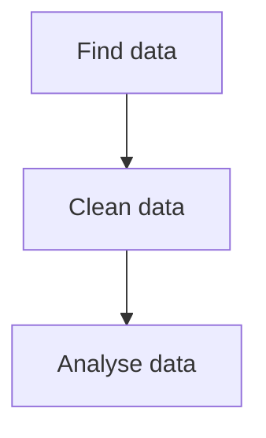

# Markdown Cheat Sheet

## Table of Contents

- [1. Text Formatting](#1-text-formatting)
- [2. Lists](#2-lists)
- [3. Links and Images](#3-links-and-images)
- [4. Code](#4-code)
- [5. Blockquotes](#5-blockquotes)
- [6. Tables](#6-tables)
- [7. Horizontal Rules and Other Elements](#7-horizontal-rules-and-other-elements)
- [8. GitHub-Specific Features](#8-github-specific-features)
- [9. Pitfalls](#9-pitfalls)

## 1. Text Formatting

### Headings

**Explanation:** Use `#` symbols to create headings. More symbols mean a smaller heading.

**Markdown source:**

```markdown
# Heading 1
## Heading 2
### Heading 3
```

**Expected result:** Three headings with decreasing sizes.

**CommonMark / GitHub**

### Paragraphs and Line Breaks

**Explanation:** A blank line separates paragraphs. Two spaces at the end of a line create a line break.

**Markdown source:**

```markdown
First paragraph.

Second paragraph.

First line  
Second line
```

**Expected result:** Two paragraphs and a line break between the last two lines.

**CommonMark / GitHub**

### Bold, Italic and Strikethrough

**Explanation:** Special characters change the appearance of text.

**Markdown source:**

```markdown
**Bold text**
*Italic text*
***Bold and italic text***
~~Strikethrough text~~
```

**Expected result:** Bold, italic, bold and italic, and crossed-out text.

**CommonMark:** Bold and italic work.  
**GitHub:** Strikethrough also works.

### Escaping Characters

**Explanation:** A backslash prevents Markdown characters from being interpreted as formatting.

**Markdown source:**

```markdown
\*This text is not italic\*
```

**Expected result:** The asterisks appear literally.

**CommonMark / GitHub**

### Inline Code

**Explanation:** Use backticks to display code within a sentence.

**Markdown source:**

```markdown
Use `print("Hello")` to display text in Python.
```

**Expected result:** The Python command appears as inline code.

**CommonMark / GitHub**

## 2. Lists

### Unordered List

**Markdown source:**

```markdown
- Apple
- Banana
- Orange
```

**Expected result:** Three bullet points.

**CommonMark / GitHub**

### Ordered List

**Markdown source:**

```markdown
1. First
2. Second
3. Third
```

**Expected result:** A numbered list with three items.

**CommonMark / GitHub**

### Nested List

**Markdown source:**

```markdown
- Data
  - Open Data
  - Private Data
- Software
```

**Expected result:** Two main items, with two sub-items under Data.

**CommonMark / GitHub**

### Task List

**Markdown source:**

```markdown
- [x] Create a GitHub repository
- [ ] Complete the cheat sheet
```

**Expected result:** A checked item and an unchecked item on GitHub.

**GitHub**

## 3. Links and Images

### Inline Link

**Markdown source:**

```markdown
[GitHub](https://github.com)
```

**Expected result:** A clickable link to GitHub.

**CommonMark / GitHub**

### Reference-Style Link

**Markdown source:**

```markdown
[GitHub][website]

[website]: https://github.com
```

**Expected result:** A clickable link using a reference definition.

**CommonMark / GitHub**

### Relative Link to Another File

**Markdown source:**

```markdown
[Lab 01](README.md)
```

**Expected result:** A link to a file relative to the current file. The target must exist at the specified path.

**CommonMark / GitHub**

### Link to a Section

**Markdown source:**

```markdown
[Go to Text Formatting](#1-text-formatting)
```

**Expected result:** On GitHub, clicking the link jumps to the Text Formatting section.

**GitHub**

### Image with Alternative Text

**Markdown source:**

```markdown

```

**Expected result:** An image if the URL points to an accessible image file. Alternative text describes the image if it cannot be displayed.

**CommonMark / GitHub**

### Image That Is a Link

**Markdown source:**

```markdown
[](https://github.com)
```

**Expected result:** Clicking the image opens GitHub if the image loads.

**CommonMark / GitHub**

## 4. Code

### Fenced Code Block

**Markdown source:**

````markdown
```python
print("Hello, world!")
```
````

**Expected result:** A separate code block. GitHub may apply Python syntax highlighting.

**CommonMark / GitHub**

### Python Code Block

**Markdown source:**

````markdown
```python
print("Hello, world!")
```
````

**Expected result:** A code block containing Python code.

**CommonMark / GitHub**

### Bash Code Block

**Markdown source:**

````markdown
```bash
echo "Hello, world!"
```
````

**Expected result:** A code block containing Bash code.

**CommonMark / GitHub**

### JSON Code Block

**Markdown source:**

````markdown
```json
{
  "course": "Data Integration",
  "lab": 1
}
```
````

**Expected result:** A code block containing JSON.

**CommonMark / GitHub**

## 5. Blockquotes

### Blockquote

**Markdown source:**

```markdown
> This is a blockquote.
```

**Expected result:** The sentence appears as an indented quotation.

**CommonMark / GitHub**

### Nested Blockquotes and Formatting

**Markdown source:**

```markdown
> First level
>
> > Second level with **bold text**
```

**Expected result:** A quotation inside another quotation, with bold text.

**CommonMark / GitHub**

### GitHub Alerts

**Markdown source:**

```markdown
> [!NOTE]
> This is a note.
```

**Expected result:** GitHub displays a note-style alert.

**GitHub**

## 6. Tables

### Basic Table

**Markdown source:**

```markdown
| Tool | Purpose |
| --- | --- |
| Python | Programming |
| GitHub | Version control hosting |
```

**Expected result:** A table with two columns and two data rows.

**GitHub:** Tables are supported.  
**CommonMark:** Test in CommonMark Dingus; table syntax is not part of core CommonMark.

### Aligned Table

**Markdown source:**

```markdown
| Left | Center | Right |
| :--- | :---: | ---: |
| A | B | C |
```

**Expected result:** The first column is left-aligned, the second centered, and the third right-aligned.

**GitHub**

### Table with a Link and an Escaped Pipe

**Markdown source:**

```markdown
| Tool | Description |
| --- | --- |
| [GitHub](https://github.com) | A \| B |
```

**Expected result:** A table containing a link and a literal pipe character inside a cell.

**GitHub**

## 7. Horizontal Rules and Other Elements

### Horizontal Rule

**Markdown source:**

```markdown
---
```

**Expected result:** A horizontal line.

**CommonMark / GitHub**

### HTML Comments

**Markdown source:**

```html
<!-- This comment is not normally visible in the rendered page. -->
Visible text.
```

**Expected result:** Only "Visible text." appears in the rendered page.

**GitHub:** Supported.  
**CommonMark:** Test the HTML comment in CommonMark Dingus.

### Collapsible Section

**Markdown source:**

````html
<details>
<summary>Show details</summary>

This content is hidden until expanded.

</details>
````

**Expected result:** GitHub displays a collapsible section.

**GitHub**

## 8. GitHub-Specific Features

### Emoji Shortcodes

**Markdown source:**

```markdown
:smile:
```

**Expected result:** GitHub renders the shortcode as a smile emoji.

**GitHub**

### Mentions and Issue References

**Markdown source:**

```markdown
@github
#1
```

**Expected result:** GitHub may turn a valid account mention or issue reference into a link. The issue reference works only if the relevant issue exists in the repository.

**GitHub**

### Footnotes

**Markdown source:**

```markdown
Here is a statement with a footnote.[^1]

[^1]: This is the footnote.
```

**Expected result:** GitHub renders a footnote reference and its corresponding note.

**GitHub**

### Mermaid Diagram

**Explanation:** Mermaid creates diagrams from text.

**Markdown source:**

````markdown

````

**Expected result:** A flowchart with three steps: Find data, Clean data, and Analyse data.

**GitHub**

### Mathematical Formula

**Explanation:** GitHub supports mathematical expressions using LaTeX syntax.

**Markdown source:**

````markdown
```math
E = mc^2
```
````

**Expected result:** The formula is displayed as a mathematical equation.

**GitHub**

## 9. Pitfalls

Record at least three things you tested that did not work as expected. Explain what happened and how you fixed it.

1. **Problem:** Strikethrough did not work in CommonMark Dingus.  
   **Solution:** I labelled strikethrough as GitHub-specific because GitHub supports it.

2. **Problem:** The Mermaid diagram did not appear immediately.  
   **Solution:** I saved the file and checked the rendered result on GitHub.

3. **Problem:** A placeholder image URL may not display an image.  
   **Solution:** I explained that the URL must point to an accessible image file.

### Line Breaks

**Markdown source:**

```markdown
First line  
Second line
```

**Expected result:** The text appears on two separate lines. Two spaces at the end of the first line create a line break in CommonMark.

### Links to Sections

**Markdown source:**

```markdown
[Go to Text Formatting](#1-text-formatting)
```

**Expected result:** Clicking the link jumps to the Text Formatting section on GitHub.

### Images with Alternative Text

**Markdown source:**

```markdown

```

**Expected result:** The alternative text describes the image if it cannot be displayed.

### Nested Blockquotes

**Markdown source:**

```markdown
> First level
>
> > Second level
```

**Expected result:** A quotation inside another quotation.

### Aligned Tables

**Markdown source:**

```markdown
| Left | Center | Right |
| :--- | :---: | ---: |
| A | B | C |
```

**Expected result:** The first column is left-aligned, the second centered, and the third right-aligned.

### HTML Comments

**Markdown source:**

```markdown
<!-- This comment is not normally visible in the rendered page. -->
Visible text.
```

**Expected result:** Only "Visible text." appears in the rendered page.

### Footnotes (GitHub)

**Markdown source:**

```markdown
Here is a statement with a footnote.[^1]

[^1]: This is the footnote.
```

**Expected result:** GitHub renders a footnote reference and its corresponding note. Test whether the same syntax works in CommonMark Dingus.

### Collapsible Section (GitHub)

**Markdown source:**

```html
<details>
<summary>Show details</summary>

This content is hidden until expanded.

</details>
```

**Expected result:** GitHub displays a collapsible section. This is GitHub-specific HTML, so test it separately from standard CommonMark.

### Python Code Block

**CommonMark / GitHub:** A fenced code block can specify a language. Syntax highlighting depends on the renderer.

**Markdown source:**

````markdown
```python
print("Hello, world!")
```
````

**Expected result:** A code block containing Python code. GitHub normally highlights the Python syntax.

### Bash Code Block

**CommonMark / GitHub:** The language identifier is `bash`.

**Markdown source:**

````markdown
```bash
echo "Hello, world!"
```
````

**Expected result:** A code block containing Bash code. GitHub normally highlights the syntax.

### JSON Code Block

**CommonMark / GitHub:** The language identifier is `json`.

**Markdown source:**

````markdown
```json
{
  "course": "Data Integration",
  "lab": 1
}
```
````

**Expected result:** A code block containing JSON. GitHub normally highlights the syntax.
