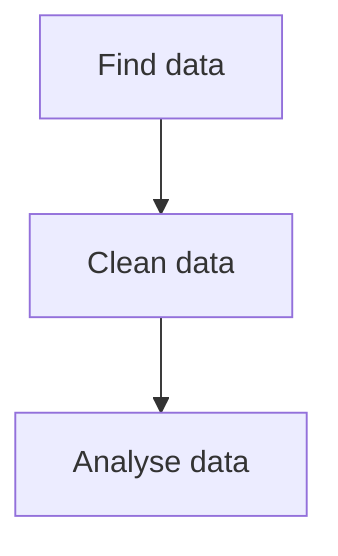

# Markdown Cheat Sheet

## Table of Contents

- [1. Text Formatting](#1-text-formatting)
- [2. Lists](#2-lists)
- [3. Links and Images](#3-links-and-images)
- [4. Code](#4-code)
- [5. Blockquotes](#5-blockquotes)
- [6. Tables](#6-tables)
- [7. Horizontal Rules and Other Elements](#7-horizontal-rules-and-other-elements)
- [8. GitHub-Specific Features](#8-github-specific-features)
- [9. Pitfalls](#9-pitfalls)

## 1. Text Formatting

### Headings

**Explanation:** Use `#` symbols to create headings. More symbols mean a smaller heading.

**Markdown source:**

```markdown
# Heading 1
## Heading 2
### Heading 3
```

**Rendered result:**

> # Heading 1
> ## Heading 2
> ### Heading 3

**Classification:** CommonMark

### Paragraphs and Line Breaks

**Explanation:** A blank line separates paragraphs. Two spaces at the end of a line create a line break.

**Markdown source:**

```markdown
First paragraph.

Second paragraph.

First line  
Second line
```

**Rendered result:**

First paragraph.

Second paragraph.

First line  
Second line

**Classification:** CommonMark

### Bold, Italic and Strikethrough

**Explanation:** Special characters change the appearance of text.

**Markdown source:**

```markdown
**Bold text**
*Italic text*
***Bold and italic text***
~~Strikethrough text~~
```

**Rendered result:**

**Bold text**
*Italic text*
***Bold and italic text***
~~Strikethrough text~~

**Classification:** Bold and italic: CommonMark. Strikethrough: GitHub.

### Escaping Characters

**Explanation:** A backslash prevents Markdown characters from being interpreted as formatting.

**Markdown source:**

```markdown
\*This text is not italic\*
```

**Rendered result:**

\*This text is not italic\*

**Classification:** CommonMark

### Inline Code

**Explanation:** Use backticks to display code within a sentence.

**Markdown source:**

```markdown
Use `print("Hello")` to display text in Python.
```

**Rendered result:**

Use `print("Hello")` to display text in Python.

**Classification:** CommonMark

## 2. Lists

### Unordered List

**Explanation:** A hyphen at the start of a line creates a bullet point.

**Markdown source:**

```markdown
- Apple
- Banana
- Orange
```

**Rendered result:**

- Apple
- Banana
- Orange

**Classification:** CommonMark

### Ordered List

**Explanation:** A number and a dot create a numbered list.

**Markdown source:**

```markdown
1. First
2. Second
3. Third
```

**Rendered result:**

1. First
2. Second
3. Third

**Classification:** CommonMark

### Nested List

**Explanation:** Indented items create a list inside a list.

**Markdown source:**

```markdown
- Data
  - Open Data
  - Private Data
- Software
```

**Rendered result:**

- Data
  - Open Data
  - Private Data
- Software

**Classification:** CommonMark

### Task List

**Explanation:** Square brackets after a hyphen create a checkbox.

**Markdown source:**

```markdown
- [x] Create a GitHub repository
- [ ] Complete the cheat sheet
```

**Rendered result:**

- [x] Create a GitHub repository
- [ ] Complete the cheat sheet

**Classification:** GitHub

## 3. Links and Images

### Inline Link

**Explanation:** Text in square brackets followed by a URL in round brackets creates a link.

**Markdown source:**

```markdown
[GitHub](https://github.com)
```

**Rendered result:**

[GitHub](https://github.com)

**Classification:** CommonMark

### Reference-Style Link

**Explanation:** A link can take its URL from a definition elsewhere in the file.

**Markdown source:**

```markdown
[GitHub][website]

[website]: https://github.com
```

**Rendered result:**

[GitHub][website]

[website]: https://github.com

**Classification:** CommonMark

### Relative Link to Another File

**Explanation:** A path relative to the current file links to another file in the repository.

**Markdown source:**

```markdown
[Repository README](../../README.md)
```

**Rendered result:**

[Repository README](../../README.md)

**Classification:** CommonMark

### Link to a Section

**Explanation:** A hash and the heading in lower case link to a section of the same page.

**Markdown source:**

```markdown
[Go to Text Formatting](#1-text-formatting)
```

**Rendered result:**

[Go to Text Formatting](#1-text-formatting)

**Classification:** GitHub

### Image with Alternative Text

**Explanation:** An exclamation mark before a link shows an image, and the text in square brackets describes it.

**Markdown source:**

```markdown

```

**Rendered result:**


**Classification:** CommonMark

### Image That Is a Link

**Explanation:** An image inside a link makes the image clickable.

**Markdown source:**

```markdown
[](https://github.com)
```

**Rendered result:**

[](https://github.com)

**Classification:** CommonMark

## 4. Code

### Fenced Code Block

**Explanation:** Triple backticks create a separate code block. A language identifier can enable syntax highlighting in supported renderers.

**Markdown source:**

````markdown
```
This is a code block.
```
````

**Rendered result:**

```
This is a code block.
```

**Classification:** CommonMark

### Python Code Block

**Explanation:** A fenced code block with the language name `python` highlights Python code.

**Markdown source:**

````markdown
```python
print("Hello, world!")
```
````

**Rendered result:**

```python
print("Hello, world!")
```

**Classification:** CommonMark (code block); GitHub (syntax highlighting)

### Bash Code Block

**Explanation:** A fenced code block with the language name `bash` highlights shell commands.

**Markdown source:**

````markdown
```bash
echo "Hello, world!"
```
````

**Rendered result:**

```bash
echo "Hello, world!"
```

**Classification:** CommonMark (code block); GitHub (syntax highlighting)

### JSON Code Block

**Explanation:** A fenced code block with the language name `json` highlights JSON data.

**Markdown source:**

````markdown
```json
{
  "course": "Data Integration",
  "lab": 1
}
```
````

**Rendered result:**

```json
{
  "course": "Data Integration",
  "lab": 1
}
```

**Classification:** CommonMark (code block); GitHub (syntax highlighting)

## 5. Blockquotes

### Blockquote

**Explanation:** A greater-than sign at the start of a line creates a quotation.

**Markdown source:**

```markdown
> This is a blockquote.
```

**Rendered result:**

> This is a blockquote.

**Classification:** CommonMark

### Nested Blockquotes and Formatting

**Explanation:** Two greater-than signs create a quotation inside a quotation, and text formatting still works there.

**Markdown source:**

```markdown
> First level
>
> > Second level with **bold text**
```

**Rendered result:**

> First level
>
> > Second level with **bold text**

**Classification:** CommonMark

### GitHub Alerts

**Explanation:** A blockquote that starts with a marker such as `[!NOTE]` becomes a highlighted box.

**Markdown source:**

```markdown
> [!NOTE]
> This is a note.
```

**Rendered result:**

> [!NOTE]
> This is a note.

**Classification:** GitHub

## 6. Tables

### Basic Table

**Explanation:** Pipes separate the columns, and a row of hyphens separates the header.

**Markdown source:**

```markdown
| Tool | Purpose |
| --- | --- |
| Python | Programming |
| GitHub | Version control hosting |
```

**Rendered result:**

| Tool | Purpose |
| --- | --- |
| Python | Programming |
| GitHub | Version control hosting |

**Classification:** GitHub

### Aligned Table

**Explanation:** Colons in the separator row set the alignment of a column.

**Markdown source:**

```markdown
| Left | Center | Right |
| :--- | :---: | ---: |
| A | B | C |
```

**Rendered result:**

| Left | Center | Right |
| :--- | :---: | ---: |
| A | B | C |

**Classification:** GitHub

### Table with a Link and an Escaped Pipe

**Explanation:** A table cell can hold a link, and a backslash shows a literal pipe.

**Markdown source:**

```markdown
| Tool | Description |
| --- | --- |
| [GitHub](https://github.com) | A \| B |
```

**Rendered result:**

| Tool | Description |
| --- | --- |
| [GitHub](https://github.com) | A \| B |

**Classification:** GitHub

## 7. Horizontal Rules and Other Elements

### Horizontal Rule

**Explanation:** Three hyphens on their own line create a dividing line.

**Markdown source:**

```markdown
---
```

**Rendered result:**

---

**Classification:** CommonMark

### HTML Comments

**Explanation:** Text between comment markers stays in the file but does not appear on the page.

**Markdown source:**

```html
<!-- This comment is not normally visible in the rendered page. -->
Visible text.
```

**Rendered result:**

<!-- This comment is not normally visible in the rendered page. -->
Visible text.

**Classification:** CommonMark

### Collapsible Section

**Explanation:** The HTML tags `details` and `summary` create a section that opens with a click.

**Markdown source:**

```html
<details>
<summary>Show details</summary>

This content is hidden until expanded.

</details>
```

**Rendered result:**

<details>
<summary>Show details</summary>

This content is hidden until expanded.

</details>

**Classification:** CommonMark

## 8. GitHub-Specific Features

### Emoji Shortcodes

**Explanation:** A name between two colons shows an emoji.

**Markdown source:**

```markdown
:smile:
```

**Rendered result:**

:smile:

**Classification:** GitHub

### Mentions and Issue References

**Explanation:** An at sign refers to a user, and a hash with a number refers to an issue.

**Markdown source:**

```markdown
@github
#1
```

**Rendered result:**

@github
#1

**Classification:** GitHub

**Test result:** In a comment on [issue #1](https://github.com/Melissakasterin/data-integration-labs/issues/1), `@Melissakasterin` and `#1` became links. In this file, `@github` and `#1` stayed plain text.

### Footnotes

**Explanation:** A marker in the text points to a note that appears at the end of the page.

**Markdown source:**

```markdown
Here is a statement with a footnote.[^1]

[^1]: This is the footnote text.
```

**Rendered result:**

Here is a statement with a footnote.[^1]

[^1]: This is the footnote text.

**Classification:** GitHub

### Mermaid Diagram

**Explanation:** Mermaid creates diagrams from text.

**Markdown source:**

````markdown

````

**Rendered result:**


**Classification:** GitHub

### Mathematical Formula

**Explanation:** GitHub supports mathematical expressions using LaTeX syntax.

**Markdown source:**

````markdown
```math
E = mc^2
```
````

**Rendered result:**

```math
E = mc^2
```

**Classification:** GitHub

## 9. Pitfalls

1. **Problem:** After pasting text into my profile README, four lines started with three extra spaces.  
   **Solution:** Up to three spaces do not break Markdown, so the page still looked right. I replaced the text with a version without the spaces.

2. **Problem:** My image examples used the placeholder URL `https://example.com/image.png`, which is not a real image file.  
   **Solution:** I replaced it with a URL that points to a real image.

3. **Problem:** I had labelled collapsible sections as GitHub only, but `<details>` also rendered in a CommonMark test with commonmark.js, the library behind the dingus.  
   **Solution:** I changed the label to CommonMark.
