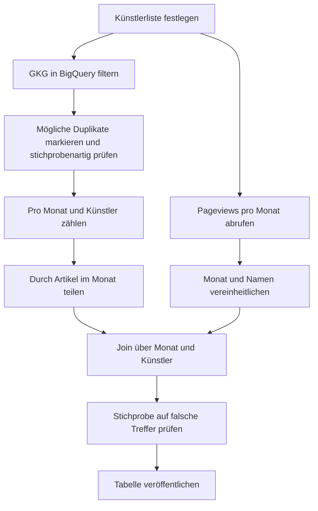

# Datensatzprofil: GDELT Global Knowledge Graph

Lab 1, Tasks 5–8 · Melissa Kasterin · Stand: 03.11.2026

Thema der Gruppe: Konzertticketpreise und öffentliche Aufmerksamkeit. Mein Kandidat deckt die Rolle **Medienaufmerksamkeit** ab.

## Task 5 · Datensatz finden

### Aufteilung in der Gruppe

Im Rahmen unserer Gruppenarbeit haben wir die Datensätze unter den Gruppenmitgliedern aufgeteilt. Jedes Gruppenmitglied hat einen bestimmten Datensatz zur Bearbeitung übernommen. Ich, Melissa, habe den Datensatz GDELT übernommen und war für die Bearbeitung und Analyse dieses Datensatzes verantwortlich.

| Gruppenmitglied | Zugewiesener Datensatz |
| --- | --- |
| Tanya | Destatis VPI – Deutschland |
| Muhammed | Eurostat HICP CP09421 – Europa |
| Idmaan | Wikimedia Pageviews |
| Melissa (ich) | GDELT |
| Esma | Wikipedia-Tourtabellen |

### Suche

Alle Suchen fanden am 03.11.2026 statt. Die erste Idee für GDELT kam aus einer Chatbot-Recherche der Gruppe, deshalb wurde die Quelle anschließend nachgesucht. Ausgeführt hat die Suchen Claude im Browser (siehe `AI_USAGE.md`).

| Quelle | Art | Suchbegriff | Ergebnis |
| --- | --- | --- | --- |
| [Open.NRW](https://open.nrw/api/3/action/package_search?q=konzert&rows=1) | Landesportal | `konzert` | 8 Treffer, Kulturstatistik zu Konzertorchestern, nichts zu Ticketpreisen oder Medien |
| [GovData](https://www.govdata.de/ckan/api/3/action/package_search?q=konzert&rows=1) | Nationales Portal | `konzert` | 24 Treffer, erster Treffer wie bei Open.NRW, denn GovData übernimmt ihn von dort |
| [Google Dataset Search](https://datasetsearch.research.google.com/search?query=GDELT%20Global%20Knowledge%20Graph) | Datensatz-Suchmaschine | `GDELT Global Knowledge Graph` | 12 Treffer, darunter eine Kopie von GDELT auf Kaggle und Auszüge auf Hugging Face |

Die Treffer auf Kaggle und Hugging Face sind Kopien. Deshalb arbeite ich mit der [Originalquelle](https://www.gdeltproject.org/data.html).

### Suche per API

| API | `count` | Erster Treffer | Lizenz im Datensatz (`license_id`) | Lizenz pro Datei (`license` unter `resources`) |
| --- | --- | --- | --- | --- |
| GovData | 24 | Selbstständige Konzertorchester, Mitglieder, Konzerte undBesuche - Land - Spielzeit | leer | `http://dcat-ap.de/def/licenses/dl-by-de/2.0` |
| Open.NRW | 8 | Selbstständige Konzertorchester, Mitglieder, Konzerte undBesuche - Land - Spielzeit | `http://dcat-ap.de/def/licenses/dl-by-de/2.0` | `http://dcat-ap.de/def/licenses/dl-by-de/2.0` |

Bei beiden steht `"isopen": false`, obwohl die Datenlizenz Deutschland Namensnennung 2.0 offen ist. Das zeigt, dass man die Lizenz selbst lesen muss. Beim selben Datensatz steht die Lizenz bei GovData nur pro Datei, bei Open.NRW auch für den ganzen Datensatz.

### Auswahl

Ich nutze den **GDELT 2.0 Global Knowledge Graph (GKG)**. GDELT ist kein einzelner Datensatz, sondern eine Sammlung. Der GKG passt am besten, weil er pro Artikel erkannte Personen, Themen und Tonalität enthält. So lässt sich pro Monat zählen, wie oft ein Künstler in den Nachrichten vorkommt.

| Teil von GDELT | Entscheidung | Grund |
| --- | --- | --- |
| GKG über BigQuery | Gewählt | Lange Zeiträume, Filter per SQL |
| GKG-Rohdateien | Für die Stichprobe | Eine 15-Minuten-Datei ist klein genug zum Ansehen, das ganze Archiv nicht |
| DOC 2.0 API | Nur zum Testen | Laut [Dokumentation](https://blog.gdeltproject.org/gdelt-doc-2-0-api-debuts/) nur die letzten 3 Monate |
| Event Database | Nein | Erfasst Ereignisse nach CAMEO, nicht die Nennung von Künstlern |

## Task 6 · Profil

### Fakten

| | GDELT 2.0 Global Knowledge Graph |
| --- | --- |
| Titel | GDELT 2.0 Global Knowledge Graph (GKG), Version 2.1 |
| Publisher | The GDELT Project, gegründet von Kalev H. Leetaru. Originalquelle, die Inhalte stammen aus weltweiten Nachrichtenartikeln |
| Link | [Datenseite](https://www.gdeltproject.org/data.html) · [Dateiliste](https://data.gdeltproject.org/gdeltv2/masterfilelist.txt). Keinen DOI gefunden |
| Formate | Tabgetrennte Textdatei mit Endung `.csv`, als ZIP. Außerdem Google BigQuery (`gdelt-bq:gdeltv2.gkg_partitioned`) |
| Größe gesamt | Sehr groß: allein der GKG von 2015 hat laut GDELT über 2,5 TB |
| Größe Stichprobe | 1 Datei `20261102181500.gkg.csv`: 1.599 Zeilen, 27 Spalten, 21.037.577 Bytes (ZIP: 6.839.823 Bytes) |
| Abdeckung | Weltweit, seit dem [19.02.2015](https://blog.gdeltproject.org/gdelt-2-0-our-global-world-in-realtime/), eine Zeile pro Artikel, 15-Minuten-Pakete |
| Letzte Aktualisierung | [`lastupdate.txt`](https://data.gdeltproject.org/gdeltv2/lastupdate.txt) zeigte am 03.11.2026 um 18:01 UTC die Datei `20261103180000` |
| Aktualisierung | Alle 15 Minuten, laut GDELT |
| Lizenz | [GDELT Terms of Use](https://www.gdeltproject.org/about.html#termsofuse): kostenlose und uneingeschränkte Nutzung, Zitat und Link Pflicht. Keine Standardlizenz |

### Sterne

**★★★.** Die Daten sind frei nutzbar, strukturiert und liegen als offenes Textformat vor. Der erste Stern setzt voraus, dass die Terms of Use als offene Lizenz gelten (siehe *Lizenz*). Für den vierten Stern fehlen URIs, die Personen, Themen und Datensätze eindeutig identifizieren. Künstler stehen nur als Text in der Datei.

### Daten ansehen

Datei: `20261102181500.gkg.csv`. Werkzeug: LibreOffice Calc auf meinem MacBook, Import mit UTF-8 und Tabulator, Unterstützung durch ChatGPT. Tone und Word Count habe ich in Hilfsspalten aus Spalte P geholt. Claude hat die Werte mit Python und `awk` gegengerechnet, die Ergebnisse stimmen überein (siehe `AI_USAGE.md`).

Beide Zahlen stecken in Spalte 16 (`V1.5TONE`), die sieben kommagetrennte Werte enthält. Diese Spalte muss man zuerst aufteilen.

| Wert | Minimum | Maximum | Mittelwert |
| --- | --- | --- | --- |
| Tone (1. Wert) | -15,56 | 16,09 | -0,78 |
| Word Count (7. Wert) | 12 | 8.146 | 507,30 |

**Leere Zellen:** In `V1PERSONS` (Spalte 12, in Calc Spalte L) sind 279 von 1.599 Zellen leer (17,4 %), gezählt mit `COUNTBLANK`.

**Auffälligkeiten:**

- **Keine Kopfzeile:** Die Spalten haben keine Namen und müssen über das Codebook zugeordnet werden.
- **Falsche Endung:** Die Datei heißt `.csv`, ist aber tabgetrennt. Die Kodierung ist UTF-8.
- **Verschachtelte Felder:** Viele Zellen enthalten Listen mit eigenen Trennzeichen (`;`, `,`, `#`, `|`).
- **Datum:** `V2.1DATE` ist in allen 1.599 Zeilen gleich, also die Zeit des Pakets und nicht die genaue Zeit des Artikels.
- **Vermutlich doppelte Artikel:** Die vollständigen URLs sind alle verschieden, das zeigt `COUNTIF` in Calc mit dem Wert 1 für alle 1.599 Zeilen. Vergleicht man nur den URL-Pfad ohne `http(s)://` und Hostnamen, bleiben 1.316 verschiedene Pfade übrig. 92 Pfade kommen mehrfach vor und umfassen zusammen 375 Zeilen, also 283 Zeilen mehr als Pfade. Bei 90 dieser Gruppen unterscheidet sich der Hostname, bei 2 nur `http` und `https`. Ein iHeart-Pfad kommt 33-mal vor, z. B. in den Zeilen 188, 257 und 343. In 88 Gruppen ist der Seitentitel nach Bereinigung gleich, bei den übrigen 4 beginnt er gleich. Das spricht für dieselben Artikel, ist aber nicht einzeln am Artikeltext geprüft.
- **Falsche Personen:** `los angeles` steht in 27 Zeilen in `V1PERSONS`, zuerst in Zeile 37.
- **Wiederholte Namen:** In `V2ENHANCEDPERSONS` (Spalte 13) kommt derselbe Name in 554 Zeilen mehrfach vor, weil jede Nennung im Text einzeln mit Position steht. In `V1PERSONS` (Spalte 12) gibt es keine zwei identischen Einträge in einer Zelle, Namen können aber trotzdem mehrfach vorkommen: In 84 Zeilen steht ein Eintrag zusätzlich als Teil eines längeren Eintrags. In L37 steht z. B. `haley stevens` und `abdul el-sayed` jeweils einzeln und noch einmal im zusammengezogenen Eintrag `abdul el-sayed haley stevens`.
- **Fragliche Treffer:** Der einzige Treffer für `taylor swift` ist laut URL ein Artikel über ein Polizeiprogramm. Den Artikel selbst habe ich nicht gelesen.
- **Leere Spalte:** `V2.1TRANSLATIONINFO` ist zu 100 % leer. Das passt zu einer rein englischen Datei, Übersetzungen liegen in eigenen Dateien.
- **Wenig Musik:** Nur 12 von 1.599 Zeilen haben das Thema `TAX_FNCACT_MUSICIAN`, davon 7 zur selben Mellencamp-Meldung.

Zusatzbefund aus [`monthly.csv`](http://data.gdeltproject.org/normfiles/monthly.csv) (Event-Daten, nicht GKG, 576 Zeilen, 2 Spalten, keine leeren Zellen): Juni 2025 hat nur 1.617.703 Events, die Nachbarmonate 3.852.043 und 3.537.845. Das sollte man im GKG prüfen, bevor man diesen Monat auswertet.

### Data Dictionary

Der Publisher dokumentiert die Spalten im [GKG Codebook V2.1](https://data.gdeltproject.org/documentation/GDELT-Global_Knowledge_Graph_Codebook-V2.1.pdf).

| Spalte | Name | Bedeutung | Typ und Einheit | Beispiel |
| --- | --- | --- | --- | --- |
| 2 | `V2.1DATE` | Zeit des Datensatzes | Ganzzahl, `YYYYMMDDHHMMSS` | `20261102181500` |
| 4 | `V2SOURCECOMMONNAME` | Name der Quelle | Text, meist Domain | `naharnet.com` |
| 5 | `V2DOCUMENTIDENTIFIER` | Kennung des Artikels | Text, hier URL | `https://naharnet.com/stories/en/323459-china-s-record-breaki…` |
| 12 | `V1PERSONS` | Erkannte Personennamen | Textliste, Trennzeichen `;`, kleingeschrieben | `donald trump;lauri myllyvirta` |
| 16 | `V1.5TONE` | Tonalität und Textmaße | 7 Werte, Tone von -100 bis +100, Word Count in Wörtern | `0,2.04678362573099,2.04678362573099,…` |

### Lizenz

**Ist der Datensatz offen?** Inhaltlich ja: Die [Terms of Use](https://www.gdeltproject.org/about.html#termsofuse) erlauben jede Nutzung ohne Gebühr, auch das Weitergeben. Verlangt wird nur die Namensnennung, das ist mit der Open Definition vereinbar. Einschränkung: GDELT nutzt eigene Bedingungen statt einer Lizenz von der Liste der Open Definition. Das ist meine Einschätzung, keine bestätigte Einstufung. Die Kopie auf Kaggle nennt CC0, zählt hier aber nicht, denn maßgeblich sind die Bedingungen des Originals. **OFFEN:** Gruppe fragt Prof. Breuer, ob das reicht, falls eine anerkannte Lizenz Pflicht ist.

Die verlinkten Artikel selbst können urheberrechtlich geschützt sein. Wir nutzen deshalb nur daraus abgeleitete Zählwerte.

**Pflicht bei der Nutzung:** das GDELT Project zitieren und auf https://www.gdeltproject.org/ verlinken.

**TASL:**

> [GDELT 2.0 Global Knowledge Graph](https://www.gdeltproject.org/data.html) von [The GDELT Project](https://www.gdeltproject.org/), genutzt gemäß den [GDELT Terms of Use](https://www.gdeltproject.org/about.html#termsofuse). Für unser Projekt zu Monatswerten zusammengefasst.
>
> [Pageviews](https://archive.sunet.se/mirror/wikimedia.org/other/pageview_complete/readme.html) von der Wikimedia Foundation, [CC0 1.0](https://creativecommons.org/publicdomain/zero/1.0/). Für unser Projekt zu Monatswerten zusammengefasst.

### Personen

**Ja, die Daten enthalten personenbezogene Daten.** `V1PERSONS` nennt echte Namen, auch von Privatpersonen. In der Stichprobe haben außerdem 684 Zeilen Autorenangaben (`PAGE_AUTHORS`) und 353 Zeilen Zitate.

So minimieren wir das:

- Wir filtern nur nach vorher festgelegten Künstlernamen.
- Wir behalten nur Monatswerte pro Künstler, keine Einzelartikel.
- Wir veröffentlichen keine Namen von Autorinnen oder Privatpersonen, keine Zitate und keine Rohzeilen.

## Task 7 · FAIR-Prüfung

| Prinzip | Bewertung | Nachweis |
| --- | --- | --- |
| F1 | ~ | Stabile URLs, z. B. die [Dateiliste](https://data.gdeltproject.org/gdeltv2/masterfilelist.txt). Auf den GDELT-Seiten und bei der Websuche keinen DOI gefunden |
| F2 | ~ | Ausführliche [Datenseite](https://www.gdeltproject.org/data.html) und Codebook, aber kein einheitlicher Metadatensatz mit Datum und Schlagwörtern |
| F4 | ✓ | Auffindbar über [Google Dataset Search](https://datasetsearch.research.google.com/search?query=GDELT%20Global%20Knowledge%20Graph), das [WTO Data Lab](https://datalab.wto.org/node/15791) und [DataHub](https://old.datahub.io/dataset/gdelt). Der DataHub-Eintrag ist seit 2014 nicht aktualisiert |
| A1 | ✓ | Rohdateien per HTTP(S) ohne Login, die Stichprobe ließ sich herunterladen. BigQuery braucht ein Google-Konto |
| I1 | ✓ | Tabgetrennter Text, UTF-8. Einschränkung: verschachtelte Felder |
| I2, I3 | ~ | Daten als `YYYYMMDDHHMMSS` statt ISO 8601 mit Trennzeichen, Länder als FIPS statt ISO 3166, z. B. `VM` für Vietnam. Jede Zeile verlinkt den Quellartikel |
| R1 | ✓ | [Codebook](https://data.gdeltproject.org/documentation/GDELT-Global_Knowledge_Graph_Codebook-V2.1.pdf) mit allen 27 Feldern. Die Stichprobe hat genau 27 Spalten |
| R1.1 | ~ | Bedingungen sind auf der Website klar, aber nicht maschinenlesbar. DataHub zeigt „License Not Specified“, Kaggle CC0, also widersprüchliche Angaben in den Katalogen |
| R1.2 | ~ | GDELT ist das Original, die Daten sind automatisch aus Nachrichtenartikeln abgeleitet. Jede Zeile nennt Quelle und URL, die Verarbeitung ist beschrieben. Die Erkennung läuft automatisch, Fehler wie `los angeles` sind nicht gekennzeichnet |
| R1.3 | ✗ | Keine Metadaten nach DCAT-AP gefunden. Der GovData-Treffer aus Task 5 hat sie dagegen, z. B. Lizenz und Format als URIs |

**Fazit:** GDELT ist inhaltlich offen, aber nur teilweise FAIR. Es ist frei zugänglich und gut dokumentiert. Es fehlen ein DOI, maschinenlesbare Lizenzangaben und standardisierte Metadaten.

**Das mache ich bei unserem eigenen Datensatz für Milestone 2 besser:**

1. Einen DOI vergeben, z. B. über Zenodo.
2. Die Lizenz maschinenlesbar in die Metadaten schreiben, z. B. CC BY 4.0, wenn alle Quellen das erlauben.
3. Kopfzeile, ISO-8601-Daten und ein Data Dictionary mitliefern und dokumentieren, wann und wie wir die Daten abgefragt haben.

## Task 8 · Kombination planen

### Zweite Quelle

**Wikimedia Pageviews:** Aufrufe von Wikipedia-Artikeln pro Künstler. Dieser Datensatz wurde in unserer Gruppe Idmaan zugewiesen (siehe Task 5). Er ist also nicht mein eigener Datensatz, sondern stammt aus Idmaans Gruppenteil. Für die geplante Kombination nutze ich ihn als zweite Quelle. Abruf über die [Pageviews-API](https://wikimedia.org/api/rest_v1/metrics/pageviews/per-article/en.wikipedia/all-access/user/Taylor_Swift/monthly/2026070100/2026103100) als JSON oder über die [Dumps](https://archive.sunet.se/mirror/wikimedia.org/other/pageview_complete/readme.html). Getestet am 03.11.2026.

Lizenz: CC0, laut [Readme der Dumps](https://archive.sunet.se/mirror/wikimedia.org/other/pageview_complete/readme.html) für alle Analytics-Datensätze.

### Gemeinsamer Schlüssel

Der Schlüssel besteht aus **Monat + Künstler**. Beide Teile passen im Original nicht zusammen.

| Quelle | Monat im Original | Künstler im Original | Nach der Bereinigung |
| --- | --- | --- | --- |
| GKG | `20261102181500` | `taylor swift` | `2026-11`, `taylor swift` |
| GKG | `20261102181500` | `john mellencamp` | `2026-11`, `john mellencamp` |
| Pageviews | `2026100100` | `Taylor_Swift` | `2026-10`, `taylor swift` |
| Pageviews | `2026100100` | `John_Mellencamp` | `2026-10`, `john mellencamp` |

Die Tabelle zeigt die Formate, nicht denselben Monat: Meine GKG-Stichprobe stammt aus dem laufenden November, die Pageviews-Beispiele aus dem letzten vollständigen Monat.

Dafür nötig: Datum auf `YYYY-MM` kürzen, Unterstriche durch Leerzeichen ersetzen und alles kleinschreiben. Künstlernamen können in den Quellen abweichen, deshalb legen wir eine Tabelle mit festen Künstlernamen und ihren Schreibweisen an.

### Granularität

Der GKG hat eine Zeile pro Artikel in 15-Minuten-Paketen, Pageviews gibt es pro Monat und Artikel. Wir fassen den GKG deshalb auf Monat und Künstler zusammen und nutzen nur abgeschlossene Monate. Monat passt zum Schlüssel der Gruppe, die Tourdaten kommen über das Jahr dazu.

Vor dem Zählen markieren wir mögliche Duplikate über den URL-Pfad und prüfen eine Stichprobe. Der gleiche Pfad ist nur ein Hinweis, die Artikeltexte haben wir nicht einzeln verglichen. Erst nach dieser Prüfung entscheiden wir, wie markierte Zeilen in die Zählung eingehen. Außerdem teilen wir durch die Gesamtzahl der GKG-Artikel im Monat, weil die Nachrichtenmenge schwankt. Dafür taugt `monthly.csv` nicht, denn die Datei zählt Events und keine GKG-Artikel.

Auch die Sprachen unterscheiden sich: Unser Pageviews-Abruf deckt nur die englische Wikipedia ab, der GKG auch übersetzte Artikel. Wir vergleichen deshalb englische GKG-Artikel mit `en.wikipedia`.

### Forschungsfragen

1. Laufen die Medienaufmerksamkeit (GDELT) und das Interesse auf Wikipedia pro Künstler gemeinsam, oder folgt eines dem anderen mit Verzögerung?
2. Bei welchen Künstlern ist die Medienaufmerksamkeit hoch, das Interesse auf Wikipedia aber niedrig, und umgekehrt?
3. Gehen Monate mit negativerem Ton der Berichte (`V1.5TONE`) mit mehr oder weniger Wikipedia-Aufrufen einher als Monate mit positiverem Ton?

Das sind Zusammenhänge, keine Belege für Ursachen. Die Tourtabellen der Gruppe können später dazukommen.

### Lizenzen

Ja, die Kombination ist erlaubt. Pageviews steht unter CC0, GDELT erlaubt Weitergabe mit Zitat und Link. Für die Veröffentlichung passt CC BY 4.0, weil es die Pflicht zur Namensnennung fortführt. Nennen müssen wir das GDELT Project mit Link. Wikimedia nennen wir freiwillig als Quelle. Die Lizenzen der anderen Datensätze der Gruppe müssen wir für das Endergebnis noch mitprüfen.

### Nächste Schritte

Vor dem ersten Lauf in BigQuery: Filter auf `_PARTITIONTIME` setzen und mit einem Dry Run prüfen, wie viele Daten die Abfrage liest. **OFFEN:** Das ist noch nicht getestet.

### Fazit

Ich würde das Projekt nicht auf GDELT aufbauen, sondern es als Anreicherung für die Medienaufmerksamkeit nutzen, denn Preise oder Tourdaten enthält es nicht. Für Monatsreihen zu bekannten Künstlern ist es gut geeignet, weil es bis 2015 zurückreicht und frei nutzbar ist. Das größte Risiko sind falsche Treffer und doppelte Artikel, die die Zählung verzerren, deshalb prüfen wir eine Stichprobe von Hand.

## Quellen

- [GDELT: Data](https://www.gdeltproject.org/data.html) · [Terms of Use](https://www.gdeltproject.org/about.html#termsofuse) · [GDELT 2.0](https://blog.gdeltproject.org/gdelt-2-0-our-global-world-in-realtime/) · [GKG Codebook V2.1](https://data.gdeltproject.org/documentation/GDELT-Global_Knowledge_Graph_Codebook-V2.1.pdf) · [Partitionierte Tabellen](https://blog.gdeltproject.org/announcing-partitioned-gdelt-bigquery-tables/)
- [Wikistats: Pageview complete dumps](https://archive.sunet.se/mirror/wikimedia.org/other/pageview_complete/readme.html) · [Pageviews-API](https://wikimedia.org/api/rest_v1/metrics/pageviews/per-article/en.wikipedia/all-access/user/Taylor_Swift/monthly/2026070100/2026103100)
- [GovData](https://www.govdata.de/ckan/api/3/action/package_search?q=konzert&rows=1) · [Open.NRW](https://open.nrw/api/3/action/package_search?q=konzert&rows=1) · [Google Dataset Search](https://datasetsearch.research.google.com/search?query=GDELT%20Global%20Knowledge%20Graph)
