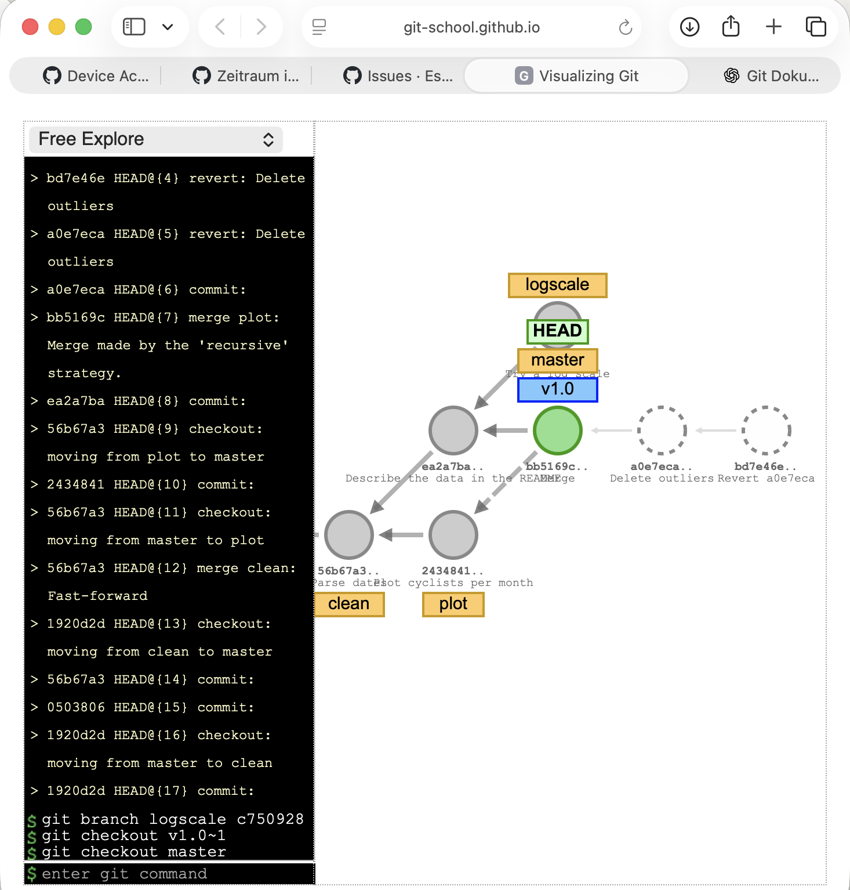

# Task 1 · Commit-Graph



## Runde 1 · Eine gerade Linie

**Vorhersage:** Ich dachte, dass beim Merge möglicherweise ein neuer Commit entsteht, weil die Änderungen aus dem Branch `clean` in `master` übernommen werden müssen.

**Was passiert ist:** Nachdem ich die drei Commits `Download the data`, `Drop empty rows` und `Parse dates` erstellt hatte, lagen diese im Graphen hintereinander auf einer geraden Linie. Beim Merge hat Git einen Fast-Forward Merge durchgeführt. Dabei wurde kein neuer Commit erstellt. Stattdessen wurde der Branch `master` einfach auf den letzten Commit von `clean` vorgeschoben. Das ging, weil auf `master` seit dem Abzweigen von `clean` keine neuen Commits dazugekommen sind.

**Antworten:**
- **Hat `git merge clean` einen neuen Commit erzeugt?** Nein, es wurde kein neuer Commit erstellt.
- **Was hat das Tool geantwortet?** „You have performed a fast-forward merge.“
- **Wohin zeigen `master` und `clean` jetzt?** Beide Branches zeigen auf denselben letzten Commit `56b67a3` (Parse dates). `HEAD` zeigt auf `master`, ich bin also auf dem Branch `master`.

## Runde 2 · Zwei Linien treffen sich

**Vorhersage:** Ich dachte, dass Git die beiden Branches möglicherweise einfach zusammenführen kann, ohne einen neuen Commit zu erstellen. Ich war mir aber nicht sicher, wie Git damit umgeht, wenn auf beiden Branches unterschiedliche Änderungen vorhanden sind.

**Was passiert ist:** Im Graphen sind von `56b67a3` (Parse dates) zwei unterschiedliche Linien entstanden. Auf dem Branch `plot` wurde der Commit `2434841` (Plot cyclists per month) erstellt. Auf `master` kam der Commit `ea2a7ba` (Describe the data in the README) dazu. Beim Merge ist ein neuer Commit `bb5169c` entstanden. Dieser hat zwei Pfeile zurück zu den beiden vorherigen Commits. Das bedeutet, dass er zwei Parents hat.

**Antworten:**
- **Welcher Commit hat zwei Parents?** Der Merge-Commit `bb5169c`. Seine beiden Parents sind `ea2a7ba` (Describe the data in the README) und `2434841` (Plot cyclists per month).
- **Warum war dieser Merge kein Fast-Forward?** Weil seit dem Abzweigen von `plot` auch auf `master` ein neuer Commit dazugekommen ist. Die beiden Linien sind also auseinandergelaufen. Git konnte `master` deshalb nicht einfach auf den Stand von `plot` vorschieben, sondern musste einen neuen Merge-Commit erstellen, der beide Entwicklungszweige zusammenführt.
- **Was würde `v1.0` in unserem Projekt markieren?** Ein gutes Beispiel wäre der fertige Meilenstein 1. Sobald unser Thema, die Forschungsfragen, die ausgewählten Datensätze und die Roadmap vollständig dokumentiert und abgestimmt sind, könnten wir diesen Stand mit `v1.0` markieren. So hätten wir eine feste Version, auf die wir später jederzeit zurückgreifen können.

## Runde 3 · Zwei Wege zurück

**Vorhersage:** Ich dachte, dass `revert` möglicherweise den letzten Commit entfernt und `reset` ebenfalls die letzten Änderungen rückgängig macht. Mir war vorher nicht ganz klar, worin genau der Unterschied zwischen den beiden Befehlen liegt.

**Was passiert ist:** Zuerst wurde mit `git commit -m "Delete outliers"` ein neuer Commit `a0e7eca` erstellt. Danach wurde `git revert HEAD` ausgeführt. Dabei wurde der ursprüngliche Commit nicht gelöscht. Stattdessen hat Git einen neuen Commit `bd7e46e` erstellt, der die Änderungen aus `Delete outliers` rückgängig macht. Anschließend wurde `git reset HEAD~2` ausgeführt (das Tool meldete „Assuming --hard“). Dabei wurden `master` und `HEAD` zwei Commits zurück auf `bb5169c` gesetzt. Die beiden neueren Commits sind jetzt gestrichelt dargestellt, weil kein Branch mehr auf sie zeigt. Sie existieren aber weiterhin.

**Antworten:**
- **Was hat `git revert HEAD` zum Graphen hinzugefügt?** Einen neuen Commit `bd7e46e`, der die Änderungen von `a0e7eca` rückgängig macht. Die bisherige Commit-Geschichte bleibt erhalten.
- **Was hat `git reset HEAD~2` verändert?** Der Branch-Zeiger `master` wurde auf einen früheren Commit zurückgesetzt. Die nachfolgenden Commits sind dann nicht mehr über diesen Branch erreichbar.
- **Sind die gestrichelten Commits weg?** Nein, sie existieren noch. Allerdings zeigt kein Branch mehr auf sie. Man kann sie beispielsweise über ihren Commit-Hash oder mit `git reflog` wiederfinden. Git kann sie später endgültig aufräumen.
- **Welchen Befehl darf man bei gepushten Commits benutzen?** `git revert`. Er erstellt einen neuen Commit und lässt die gemeinsame Geschichte unverändert, sodass Teammitglieder ihn normal mit `git pull` bekommen. `git reset` dagegen schreibt die Geschichte um: Wer den Commit schon heruntergeladen hat, hat dann eine andere Geschichte als GitHub. Beim nächsten Pull würde der entfernte Commit über einen Merge wieder zurückkommen, und GitHub nimmt so einen Push ohnehin nur mit `git push --force` an.

## Runde 4 · Verloren und wiedergefunden

**Vorhersage:** Ich dachte, dass Git beim Wechsel zu einem älteren Commit möglicherweise einen neuen Branch erstellt oder dass meine nächsten Änderungen automatisch zu `master` gehören. Mir war vorher nicht klar, was passiert, wenn HEAD direkt auf einem Commit steht.

**Was passiert ist:** Zuerst wurde `git checkout v1.0~1` ausgeführt. Dadurch bin ich zum Commit `ea2a7ba` (Describe the data in the README) gewechselt, dem ersten Parent von `v1.0`. Oben wurde `HEAD: ea2a7ba (detached)` angezeigt. Das bedeutet, dass HEAD direkt auf einem Commit stand und nicht auf einem Branch. Anschließend wurde mit `git commit -m "Try a log scale"` der neue Commit `c750928` erstellt. Da HEAD detached war, wurde kein Branch-Zeiger mitbewegt. Als ich danach mit `git checkout master` zurück zu `master` gewechselt bin, war der Commit `c750928` im Graphen gestrichelt. Kein Branch zeigte mehr auf ihn. Mit `git reflog` konnte ich den Commit trotzdem wiederfinden. Anschließend wurde mit `git branch logscale c750928` ein neuer Branch erstellt, der auf diesen Commit zeigt. Dadurch war er wieder mit einem durchgezogenen Kreis im Graphen zu sehen.

**Antworten:**
- **Was steht über dem Graphen nach `git checkout v1.0~1`?** `HEAD: ea2a7ba (detached)`. HEAD steht direkt auf dem Commit `ea2a7ba` und ist nicht mit einem Branch verbunden.
- **Was passiert mit „Try a log scale“, wenn ich zurück auf `master` wechsle?** Der Commit `c750928` bleibt bestehen, aber kein Branch zeigt mehr auf ihn. Deshalb wird er im Graphen gestrichelt dargestellt.
- **Hash aus `git reflog` und Rettung:** Der Hash lautet `c750928`. Im Reflog stand:
  ```text
  bb5169c HEAD@{0} checkout: moving from c750928 to master
  c750928 HEAD@{1} commit:
  ```
  Durch `git branch logscale c750928` habe ich einen neuen Branch namens `logscale` erstellt, der auf diesen Commit zeigt. Dadurch ist der Commit wieder über einen Branch erreichbar.